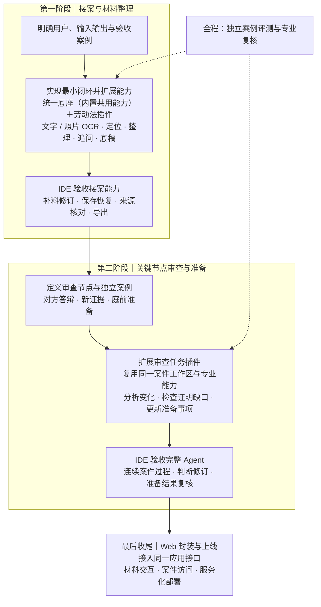

# 法律 Agent 实现规划

Web 前版本已实现[接案](../接案与材料整理/README.md)与[关键节点审查](../关键节点审查与准备/README.md)两段 IDE 工作流。答辩、新证据和庭前准备共用接案案件、版本与保存点。最新验证按[Web 前验收说明](../评测与验收/Web前验收说明.md)记录。以下底座小步数据保留为历史实施记录。

更新：2026-11-02。状态：宿主、材料/OCR、修订引用、案件管理、全案回滚和四项信息整理已有实现；本轮按计划完成**模型与执行支持、成果整理与导出初版**。可在终端提出任务，选择已注册工具，保存步骤和读取/复核检查点并恢复；补料后保留旧结果，形成后续处理和版本化底稿，支持 Word/Markdown/JSON 导出。操作、验收与限制见[本轮说明](../底座/docs/execution-and-outputs.md)。普通 `createRuntime` 仍默认 32 个能力，信息任务按配置额外装配 3 个能力。项目主线仍为接案与材料整理 → 关键节点审查与准备，均先在 IDE 验收，Web 最后；不使用 Dify，自我进化后置。

## 目录与步骤对应

项目统一存放在工作区的 `法律agent3.0` 文件夹中。

| 文件夹 | 对应的实现步骤 |
| --- | --- |
| 项目规划 | 保存项目背景、架构图、实现规划与职责笔记。 |
| 需求与验收案例 | 明确用户、输入输出及独立验收案例；后续补充节点审查案例。 |
| 底座 | 宿主、材料/OCR、修订引用、案件分区/回滚、信息整理 loop、会话与工具执行、恢复快照，以及底稿版本和导出。共用能力已有初版及有限虚构验收。 |
| 底座/docs/common-capabilities.md | 原“共用能力插件”目录已归并入底座，共用职责说明在此；源码、依赖与 IDE 入口统一管理。 |
| 劳动法插件 | 第一阶段的劳动法专业能力，第二阶段继续扩展。 |
| 接案与材料整理 | 第一阶段的接案任务与业务集成。 |
| 关键节点审查与准备 | 第二阶段的节点定义、审查任务与业务集成。 |
| 评测与验收 | 贯穿两阶段的业务评测与专业复核；底座自身测试仍随底座代码保存。 |
| Web封装与上线 | 两阶段均在 IDE 验收后的产品化收尾。 |

宿主与共用能力在底座内部按模块交付，劳动法插件提供专业需求、复核及节点准备事项。两段业务说明位于对应目录。案件可保存材料、附件、人工进度、整理记录、执行快照和底稿，节点报告随底稿参与全案回滚。

## 当前底座的小步实施清单

- [x] 最小插件协议、宿主、可替换测试插件及技术验证。
- [x] **前一步技术验收通过：** 统一入口默认装配材料能力；登记文字和 PNG/JPEG 照片，保存原件、来源标签、分组标识及 SHA-256；照片可调用中英文 OCR，识别结果与失败尝试单独保存，重启后可读回。
- [x] **前一轮修订与引用验收通过：** 用户直接提交编辑后的全文，保存独立修订版本；列出和读取文字版本；引用绑定具体材料、版本及 UTF-16 位置，读回时核对版本哈希与摘录；原图和旧版本保留。
- [x] **前一轮收尾核验通过：** 版本、引用、独立消费者和 CLI 回归通过，覆盖缺失材料、错误版本、无效位置、原件保留及停止重启；文本导出、编辑、保存、引用与读回演示通过。当时类型检查、构建及 78 项测试全部通过。
- [x] **案件工作区初版已验收：** 案件创建、列表搜索、打开、资料与办理进度更新、历史记录；每案独立保存材料及原始附件，复用 OCR、修订和引用；IDE 的案件管理 CLI、演示及带案件归属的编辑草稿。当时类型检查、构建和 108 项测试通过。
- [x] **前一轮全案回滚已验收：** 建立与列出保存点、预览变化、恢复整个案件、自动保留回滚前保存点并支持撤销；全部案内写入统一参与案件版本检查。当时类型检查、构建和 144 项测试通过，IDE 演示及构建产物验证通过。
- [x] **前一轮 loop 控制第一步已验收：** 专业需求、读取与复核独立接入，必要补查有理由；固定输入版本、拒绝错误出处、限制重复任务与预算、区分退出状态。完整运行记录纳入案件保存点，重启、回滚与撤销通过。使用确定性 test 插件，当时类型检查、构建及 183 项测试通过。
- [x] **四项整理功能代码已实现：** 人物/时间/事件与关系；跨材料关联及语义归组；可比记载的冲突；专业需求已有、缺失与待复核状态。接入 DeepSeek 提取、逐字引用与规范化、单独模型调用的语义准入复核，提供 `information -- run/show`；结构化结果随案件保存/恢复。
- [x] **有限独立虚构材料验收已完成：** 三组场景分别实际调用 DeepSeek 并通过当前验收检查；预期答案不进入运行时，失败报告保留。这不是单次连续批量全部通过，也不是复杂真实卷宗或法律业务质量验收。结果、超时及延迟限制见[信息整理说明](../底座/docs/information.md)。自我进化、自动提示优化、模型训练和网页不加入本小步。
- [x] **模型与执行支持初版：** 终端连续任务、模型选择已注册工具、案件范围与参数检查、回复复核、预算与退出；每个工具和整理读取/复核边界保存检查点，重启复用确认结果，写操作核对回执。补料建立关联后续任务，自动恢复不清空预算。
- [x] **成果整理与导出初版：** 固定来源的事实版底稿、材料索引、时间线、冲突/缺项、专业贡献区块、版本差异；案内保存并导出 Word/Markdown/JSON。快照一致与分析覆盖分开标记，未解析附件和文字分支明确保留。
- [x] **有限连续场景验收：** 虚构材料经真实 DeepSeek 调用，实际中断后换实例恢复、不重复首条已确认读取、保留预算，补料发现差异并生成新底稿，旧版保留。Word 样例实际渲染并逐页检查。结果和耗时限制见[本轮说明](../底座/docs/execution-and-outputs.md)；自动化检查及最终构建结果统一维护在底座运行说明。
- [x] **专业接案与节点审查代码：** 劳动法插件接入专业复核，终端可按案件和当前材料版本执行接案、答辩、新证据与庭前准备。记录层、虚构材料真实 API 及承办人实务验证分别记账。

前一步材料功能技术验收（2026-10-31，Node.js 24.15.0）：类型检查、构建及当时的 45 项测试通过（原有 33 项＋材料 8 项＋OCR 4 项，含超时及 worker 创建失败后的清理回归）。真实 OCR 引擎从虚构中英文 PNG 中正确读出“九月工资6000元”和英文文字，并返回两行像素框；源码与构建产物的实际识别、坏图失败后重试、重启读回均通过。这是上一步的历史记录，不是本轮最终测试总数。

前一轮人工修订与引用技术验收（2026-10-31，Node.js 24.15.0）：`npm.cmd run typecheck`、`npm.cmd test`、`npm.cmd run build` 通过，**当时 78 项测试全部通过**（此前 45 项＋版本 15 项＋引用 9 项＋消费者工作流 5 项＋CLI 4 项）。实际运行 `npm.cmd run demo:versions`，原版本“8000元”、修订版“6000元”及各自引用在停止重启后分别保留。CLI 回归实际执行导出、修改文本、连续保存两次修订和引用读回，并检查重复摘录需明确位置、已有草稿不覆盖、受管目录及 junction 拒绝、坏 UTF-8 不提交。

前一轮构建产物烟测通过：直接导入当时的 `dist/index.js` 创建运行时，确认 9 个默认材料能力，恢复源演示写入的两个文字版本，并核验旧“8000元”和新“6000元”的两个固定引用。

前一轮默认材料能力由 4 个扩为 9 个；原 `materials.read@1` 输出保持原样，原文 `text` 字段不会被修订文字替换。纯文本原文的文字版本 ID 为 `material.id`，成功 OCR 的版本 ID 为 `attempt.id`；人工修订生成新 UUID，记录基准版本、基准文字哈希、编辑者自报称呼及可选备注。修订只追加，允许基于旧版本创建分支，没有自动选择的 `latest` 版本。

固定版本引用保存材料 ID、版本 ID、文字 SHA-256、UTF-16 半开区间 `[start,end)` 与原样摘录；读回核验后返回指定版本和原件路径。人工修订没有继承旧 OCR 行框。引用匹配只说明该版本中存在这段文字，不能证明原件真实性、OCR 正确或法律事实成立。真实照片复杂场景与法律业务尚未验收，材料功能结果不能作为整个接案阶段的验收。

每完成一个小步，更新本清单、实际测试结果及下一步范围；不能把底座材料功能验收当作整个接案阶段验收。

编辑交互：用户直接修改文字，无需通过聊天描述改动。前一轮提供了独立的版本查询、读取、提交全文修订和引用接口，以及 IDE 的“导出 UTF-8 文本 → 在编辑器中修改并保存 → 提交为新版本”CLI。本轮编辑命令增加 `--case`，草稿元数据保留案件归属，保存仍落在原案件。原图与旧版本保留，已有引用继续绑定原先版本。原图对照、文本框编辑和点击保存的在线页面仍在最终 Web 阶段接入同一接口，尚未实现。

## 已实现的案件项目工作区

已实现并通过本轮技术验收。每案存放在 `dataDir/cases/{caseId}/`，分别保存 `revisions` 案件资料与进度修订记录、`materials` 材料、`files` 原始附件。所有分案能力显式使用 `caseId`，不维护会在窗口间串用的“当前案件”。旧 `dataDir/materials` 保留原位，不自动迁移归案，也不作为跨案查询的回退来源。

- 案件可创建、列出、按名称或案号搜索、打开，并保存资料和办理进度；进度包括自由填写的 `stage` 与人工选择的 `active / paused / closed`，`closed` 仍可继续存取。
- 资料与进度每次更新保存历史，提交携带 `expectedRevision`；并发更改同一旧版本时明确拒绝冲突，避免覆盖另一人的更新。操作人称呼为调用者自报信息。
- 每案复用已有文字／图片登记、OCR、文字修订和固定版本引用；可查看案件目录并导出原件。PDF、Word 等可作为原始附件按字节保存和导出，单附件上限 50 MiB，本轮不解析这些文档。
- IDE 提供 `cases`、`agent` 与 `outputs` 等入口；案件项目管理页面留到最后 Web 阶段。当前仍无登录权限和云端同步，任务执行由本地应用服务承担。

案件工作区初版技术验收（2026-10-31，Node.js 24.15.0）：类型检查、构建和 **当时 108 项测试全部通过**（历史 78 项＋案件资料 16 项＋分案存取 7 项＋公共协议流程 5 项＋CLI 2 项）。`demo:cases` 实际运行验证 A/B 案独立材料、原始附件按字节取出、人工阶段与状态、停止重启恢复及跨案拒绝；当时构建产物导入默认 28 个能力，并恢复源演示的案件内容、进度、历史和原始附件字节，跨案拒绝也通过。回归另覆盖进度并发冲突、旧全局材料不回退及编辑草稿案件归属。

### 已实现的全案保存点与回滚

用户明确选择“整个案件恢复到保存点”。保存点覆盖案内资料/进度、材料/附件、OCR、版本/引用、loop、执行快照和底稿。保存点后的内容退出当前视图，原件和历史不删除；固定引用仍可按明确 ID 核验。案件 ID 与创建时间保持，修订号继续增加。后续法律判断与专业任务依赖加入时，也需接入同一约定。

使用流程：`checkpoint` 建立 → `checkpoints` 列出 → `rollback-preview` 核对变化 → 携带预览中的版本号和 token 执行 `rollback`。每次恢复自动建立回滚前保存点，与恢复记录原子提交；再次恢复该自动保存点即可撤销。预览后发生任何案内保存，旧预览失效。两个普通新增保存可以合并追加；回滚前启动的 OCR 等迟到保存会明确拒绝，不混入恢复后的视图。

实现采用原有本地文件和同一不可覆盖的案件版本日志，没有另建数据库或网页。旧案首次访问登记已有材料清单；之前仅记录进度的历史不能追溯补成完整材料快照。已导出的副本和未提交草稿不改写。

历史技术验收（2026-11-01）：`typecheck`、`test`、`build` 通过，**当时 144 项测试全部通过**。在初版 108 项基础上新增日志、全案回滚、公共能力流程、并发保存与旧案初始化、CLI 恢复/撤销检查，共增加 36 项（含子测试）。实际运行 `demo:cases`、`demo:rollback`；直接导入当时的 `dist/index.js` 验证默认 32 能力、回滚后重启、撤销以及源码演示数据读回，均通过。这是历史记录，不是当前测试总数；该轮使用虚构数据，未重新进行复杂照片 OCR 或法律业务验收。

在案件项目管理与回滚之后，已完成下列 loop 控制，并继续实现四项信息整理。完整法律判断与任务依赖仍待后续集成。

## loop 控制与当前四项信息整理

用户确认：先声明需求、带着需求读取、再检查，这构成一个 loop；先专注循环，自我进化后置。代码位于 `底座/src/loops`，运行 `npm.cmd run demo:loop` 查看中文两轮轨迹，详情见[loop 说明](../底座/docs/intake-loop.md)。

- 专业 test 插件声明需求并复核记录，读取 test 插件按任务定位准确原话；任务层控制往返，避免相互依赖。更换读取提供方或专业测试策略，无需改动循环引擎。
- 一次运行明确案件、材料文字版本和哈希。专业复核可以调整补查指令，已有需求 ID 在本次运行内固定；新的需求范围另开运行。
- 每条候选附出处；读取范围与“未找到”区分。拒绝伪造摘录、错版本、未检查来源及无记录却称已满足的输出。出处正确和语义正确分别验收。
- 需求满足、待人工核对、没有新读取动作、预算耗尽有不同状态。默认 4 轮/12 次读取；任务缓存纳入需求、指令及目标来源，避免重复执行同一任务。结构化同义记录现可关联归组并保留各自出处，任意指令的语义等价去重仍未实现。
- 运行记录保存需求、插件版本、读取与复核轨迹、候选与出处、预算和退出原因。当前可在读取和复核完成边界保存检查点，恢复时复用已确认步骤；未返回的模型调用重新发起。记录按案件隔离并纳入保存点，过期或回滚后的迟到保存明确拒绝。

历史技术验收（2026-11-01）：类型检查、构建及 **当时 183 项测试全部通过**（历史 144＋循环 28＋存储恢复 8＋示例/CLI 3，含子测试）。`demo:loop` 实跑两轮并重启读回；当时的 `dist/index.js` 验证循环、重启、全案回滚/撤销及源码演示记录读回通过。数据与提供方均为确定性测试，不是 LLM 或法律业务质量验收，也不是当前测试总数。

当前已在同一契约接入 DeepSeek 与四项功能：按专业声明提取结构化候选，逐字核验引用及金额/日期等字段；单独模型调用逐条复核需求相关性、原文支持、角色与肯否，不合格有限纠正，仍不合格拒绝。随后比较人物/事件关联、同义记录与可比冲突，再核对已读范围、必要字段、支持类型与需求满足状态。来源标签不代表鉴真，语义复核不能保证不漏错。

默认任务另限 24 次实际模型调用，提取、复核和纠正共用预算；适配器已有网络超时、取消及有限重试。结果和逐轮分析保存在 loop 中，提交时拒绝来源过期或并发覆盖。`information -- run` 执行，`show` 离线读取已保存 JSON；`demo:information` 使用独立虚构材料实调 API，验收预期只在评分侧。代码已实现，已完成有限的独立虚构材料验收，结果与限制见[底座/docs/information.md](../底座/docs/information.md)。各场景分别验收与单次连续批量执行不同，不能据此宣称真实复杂卷宗质量已经验证。

会话执行、工具目录、检查点恢复和成果导出已在同一 loop 与案件约定上完成初版。下一步按接案样例集成劳动法专业插件、完整任务及专业判断依赖；自我进化保留远期研究，不加入当前工作。

## 本轮会话执行与成果交付

执行顺序按原计划完成：终端会话 → 工具选择 → 进度保存与恢复 → 补料后继续 → 统一成果结构 → 可阅读底稿 → 版本保存和导出。入口为 `npm.cmd run agent`；可按案件 ID 或唯一名称打开，指定会话恢复，也可离线查看保存状态。插件使用统一工具元数据、信息需求配置及专业成果区块，不把劳动法名称写死在执行器中。

恢复只复用已确认完成的步骤。自动继续保留已耗预算，写操作先核对是否提交；不能确认时明确停止。补料或修订建立关联的新处理，原结果和底稿不覆盖。执行快照与底稿进入案件版本日志和全案保存点，避免回滚后的旧执行重新混入当前视图。

底稿从固定整理运行生成，保留来源、冲突和未明确事项。`currentInputMatches` 检查生成快照是否一致；`analysisCoversCurrentInput` 和范围清单另外说明是否覆盖当前材料。上传 PDF/Word 等原始附件目前不等于解析；多个文字分支不自动取最新。导出的外部副本不随回滚改写。

已使用真实 DeepSeek 完成有限虚构连续场景，包含实际中断、换实例恢复、补料和新旧底稿；Word 样例经实际渲染和逐页检查。具体证据与时限限制集中见[终端执行与成果导出](../底座/docs/execution-and-outputs.md)。当前没有真实复杂卷宗或专业法律质量验收，也不据此承诺稳定响应时长。

## 阶段交付与验收

| 阶段 | 实际交付 | 进入下一阶段的依据 |
| --- | --- | --- |
| 一：范围与样例 | 明确服务劳动者一方的律师或法援承办人；限定接案整理范围；建立开发样例、独立案例和评价表。 | 预期事实、材料来源、关键缺口可复核；模拟样例与真实脱敏案例分开标记。 |
| 一：最小闭环与扩展 | TypeScript 工程、CLI、内置共用能力的统一底座、插件契约、模型适配与持久化；先补齐文字及照片 OCR、来源与版本引用，再用一份材料完成整理、缺口判断、必要追问和底稿，逐步扩展共用能力与劳动法插件。 | 原件与识别结果分开保存；结果带出处，已知信息不重复询问；法源、适用范围和版本可追溯；不适用、缺信息和专业判断分别表达。 |
| 一：接案功能验收 | 事实时间线、材料索引、初步问题、关键缺口及接案底稿；支持补料、纠正、保存恢复和导出。 | 在 IDE 终端完整完成接案任务；原始陈述保留，判断与来源可核对；独立案例及专业复核发现的问题经修复和回归。 |
| 二：节点与案例 | 定义具体审查任务、目标、材料版本和独立验收集，先选择明确节点实现，再扩展到其他约定节点。 | 每个节点明确触发条件、所需材料和预期准备成果；不能用接案摘要代替节点审查验收。 |
| 二：审查插件与整体验收 | 复用运行时、案件工作区及劳动法能力，扩展对方答辩、新证据和庭前准备任务。输出变化清单、争点与证据关系、证明缺口及优先准备事项。 | 按实际顺序输入案件材料；新信息引起有依据的判断和任务修订，原始陈述保留；在 IDE 中跑通从接案到约定节点审查的连续过程，专业复核遗漏、误报及复核时间。 |
| 最后：Web 产品化收尾 | 通过已有应用服务接口接入网页；实现材料上传、原文定位、补料与修订展示、案件访问管理、服务端持久化与部署。 | 两大功能已在 IDE 验收；网页复用同一核心与插件，完整业务场景在浏览器中通过验收，补齐界面与部署问题。 |

## 实施约束

- 项目主线只有两大功能阶段，二者分别在 IDE 验收，Web 放在整个实现流程最后作为产品化收尾。
- 共用能力与劳动法能力在最小契约稳定后可以并行；独立案例评测与专业复核贯穿两阶段。
- 宿主与默认共用能力合为一个可运行底座，内部按职责组织和测试；专业插件使用公开契约，无需重复实现材料保存与 OCR。底座先以本地文件保存材料；SQLite 等存储仅在实际需求出现后考虑。
- 照片解析先支持 PNG/JPEG；原图与 OCR 派生文字分开保留，识别失败不丢原件，识别结果待核对。PDF/Word 等本轮仅按原始附件存取，解析、复杂版面及手写识别按案例需求另行扩展。
- 从第一阶段起保留有类型的应用服务接口：提交材料、继续任务、读取状态和导出结果。业务逻辑通过接口调用，独立于终端交互、HTTP 和页面；暂不建设 Web 服务和账号页面。
- 先实现最小完整案例，再根据真实缺口扩展运行时。采用模块化单体，不使用 Dify。
- 评测案例与开发样例分开；标准答案不进入运行时。与同一模型直接整理的结果比较，未取得真实案例前仅报告模拟验证。
- 指标目标值在样例基线和专业复核后确定；实现质量通过前不宣称提升胜诉率或已具备通用、自我进化能力。

## 扩展议题

统一插件接口、版本及最小开发支持在第一阶段随实际能力实现。其他部门法验证、第三方插件生态和自我进化保留为单独的远期议题，不增加本轮主线功能阶段。记录人工纠正与案例反馈，为后续验证提供依据。
