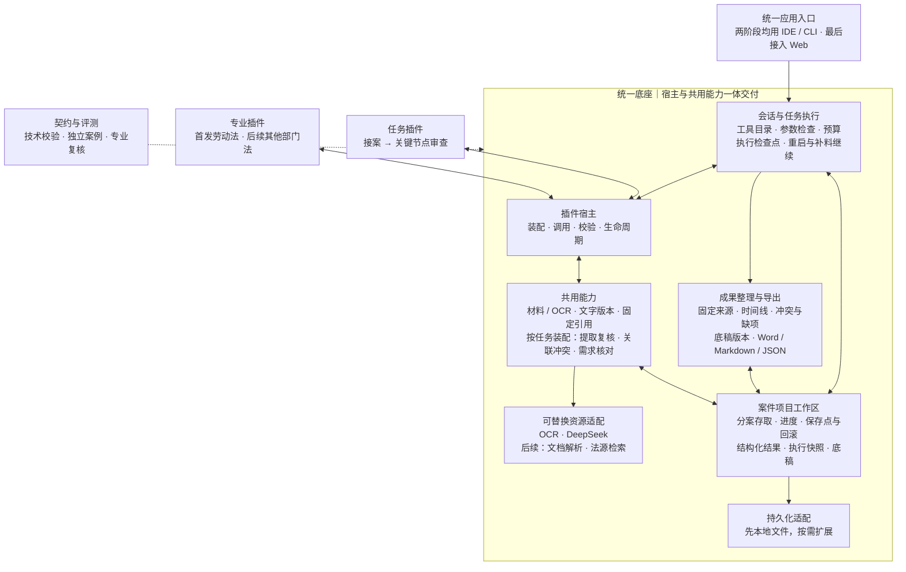

# 法律 Agent 项目架构

更新：2026-11-02。下图为总体架构。宿主、材料/OCR、修订引用、案件管理、全案回滚及信息整理 loop 已有实现；本轮完成会话执行、模型工具选择、运行检查点与恢复，以及底稿版本和导出初版。操作和有限虚构材料验收见[终端执行与成果导出](../底座/docs/execution-and-outputs.md)。默认运行时仍装配 32 个能力，信息任务按配置额外装配 3 个能力，应用层工具目录统一供模型选择。两大阶段仍为接案整理、关键节点审查，均先在 IDE 验收，Web 最后；首发专业插件为劳动法，不使用 Dify，自我进化后置。

当前 loop 通过公开能力契约协调需求与读取提供方：声明需求 → 按指定版本读取 → 引用/字段校验及单独模型语义复核 → 结构化比较与需求核对 → 必要补查或退出。DeepSeek 提取候选，语义复核逐条检查相关性、支持、角色与肯否，不合格有限纠正后拒绝；代码负责规范化、比较、预算与提交。完整轨迹和结构化结果纳入案件保存点。确定性 `demo:loop` 与实际调用 API 的 `demo:information` 分别检查控制机制与有限虚构材料效果，均不证明真实复杂卷宗质量，详见[loop 说明](../底座/docs/intake-loop.md)与信息整理说明。

图中箭头表示调用与数据交换，不表示固定法律处理顺序。共用模块随底座交付，无需使用者另装公共包；材料与案件默认装配，信息任务按配置装配 3 个能力。会话层通过工具目录调用能力，统一保存步骤和预算，并生成版本化成果。案件区保存材料、loop、执行快照与底稿；完整法律判断及其变更依赖仍由后续专业业务完善。

## 职责边界

| 模块 | 职责 |
| --- | --- |
| 应用入口 | 终端和后续网页调用同一应用服务，接收案情、材料、补充与修正，展示结果及来源。 |
| 统一底座与插件宿主 | 底座统一提供宿主与共用能力；宿主管理依赖、调用、校验、工具元数据和清理。会话执行及恢复位于应用层；法律规则由相应插件提供。 |
| 会话执行与循环控制 | 会话层协调模型动作与工具，固定案件范围并保留步骤、预算与恢复点；整理 loop 继续协调专业需求、定向读取与复核。完整接案或审查策略后续由任务插件接入。 |
| 共用能力与成果 | 材料/OCR、版本引用、结构化整理、关联/冲突和需求核对；统一事实版底稿展示时间线、来源和未知项，按版本保存并导出。具体法律重要性和专业成果由插件贡献。 |
| 专业插件 | 声明适用范围、法源版本、争点及事实因子，提供规则、证明任务、必要追问、计算和校验能力。 |
| 资源适配 | OCR 与可替换 `JsonModel` 端口上的 DeepSeek，具备超时、取消、有限重试和错误脱敏；用于动作选择、整理及语义复核。Word 输出由导出器生成，输入文档解析和法源检索按需加入。 |
| 案件项目工作区 | 独立案件资料、材料/附件、人工进度及全案保存点，支持预览、恢复和撤销。所有案内保存参与版本检查，包含 loop、执行快照与底稿；完整法律判断依赖后续加入。 |
| 持久化适配 | 按案件保存状态日志、保存点、原件、OCR、版本引用、loop、运行检查点和成果；恢复视图而不删除历史。SQLite 等按实际需求引入。 |
| 插件 SDK 与评测 | 提供能力声明、输入输出契约、版本兼容检查与测试夹具，验证插件行为。 |

## 统一插件契约

- 身份与依赖：标识、版本、宿主兼容范围、依赖和提供的能力。
- 适用范围：任务、地域、时间、程序阶段及尚不明确的适用条件。
- 能力接口：有类型的输入输出，明确成功、缺信息、不适用、失败等结果。
- 来源与版本：专业结论指向材料及法源，保留规则版本与待核查项。
- 生命周期与事件：注册、停用、订阅及清理，声明会影响的案件对象。
- 验收案例：正常样例、反例、边界和补充材料后的修订测试，运行时不接触评测标准答案。

统一协议约束接入与协作，允许领域扩展字段及不同任务策略。劳动场景通过不能证明跨部门法通用，需以后用其他专业插件验证。

## 当前材料、修订与引用边界

第一小步支持纯文本和 PNG/JPEG 照片。登记保留来源标签、分组标识、原件及 SHA-256；照片识别通过可替换的本地中英文 OCR 适配器完成。每次识别的结果或失败记录分别保存并关联原件，可重试和重启读回；识别文字始终待核对，不能直接视为事实确认。

原图不会被 OCR 或人工修订文字覆盖。纯文本原文的文字版本 ID 为 `material.id`，成功 OCR 的版本 ID 为 `attempt.id`；人工修订生成新 UUID，记录 `baseVersionId`、`baseTextSha256`、编辑者自报称呼及可选备注。修订只追加，允许基于旧版本形成分支；没有自动选用的 `latest` 版本。原 `materials.read@1` 输出保持原样，不把修订文字写入原文的 `text` 字段。

固定版本引用保存材料 ID、文字版本 ID、文字 SHA-256、UTF-16 半开范围 `[start,end)` 与原样摘录。创建及读回时核对范围、版本与摘录，读回返回原件路径和对应文字版本。人工修订不继承旧 OCR 行框，不能据此宣称修订摘录已精确定位到图片像素。哈希与引用核验用于检查来源一致性，不证明原件真实、OCR 正确或法律事实成立。

人工纠正接口直接接收编辑后的全文，无需经过 LLM。前一轮提供了 IDE 的文本导出、编辑、提交修订 CLI 与版本引用演示，并完成技术验收。本轮 `materials:text` 增加 `--case`，编辑草稿保留案件归属并保存回该案。最终 Web 页面提供原图对照、直接编辑文本和点击保存，仍待最后 Web 阶段接入同一接口。智能案件业务对象、PDF/Office 解析和复杂版面识别按后续案例推进。

前两步的历史验收：材料/OCR 在 Node.js 24.15.0 下通过当时的 45 项测试及真实测试图片识别；修订与引用随后通过类型检查、构建和当时的 78 项测试，实际运行修订演示及 CLI 文本导出、编辑、两次连续保存和引用读回。这些不是本轮案件工作区的最终测试总数，详见[实现规划验收记录](C:/Users/13700/Documents/LAW_Agent/法律agent3.0/项目规划/implementation-roadmap.md)。真实照片复杂场景与法律业务尚未验收。

前一轮构建产物导入及重启读回通过：当时的 `dist/index.js` 可创建默认 9 材料能力运行时，读取源演示的两个文字版本，旧新固定引用分别核验为“8000元／6000元”。

## 案件项目工作区与保存边界

本轮已实现并通过技术验收。每个案件在 `dataDir/cases/{caseId}/` 下保存 `revisions` 资料与进度历史、`materials` 材料和 `files` 原始附件；每次操作显式携带 `caseId`。分案 OCR、文字版本与引用复用原有业务模块。旧全局材料保留原位，不自动迁移或归案，不作为案件查询的回退来源。

案件可创建、列表搜索、打开和修改资料；办理进度由用户填写 `stage` 并选择 `active / paused / closed`。关闭状态仍可存取。资料更新携带 `expectedRevision`，冲突明确拒绝，已提交历史继续保留。PDF/Word 等本轮只作为不超过 50 MiB 的原始附件按字节存取和导出，不解析内容。

IDE 提供案件管理、回滚、文字编辑和信息整理命令；本轮 `agent` 可连续对话和选择已注册工具，`outputs` 管理底稿版本及文件导出。会话绑定案件，附件路径由使用者明确选择；模型提出动作，底座检查范围和参数再执行。完整法律分析与登录权限仍未实现，最终项目管理页面留到 Web 阶段。

历史验收：案件工作区初版通过当时的 108 项测试与 28 能力构建产物验证；全案回滚通过当时的 144 项测试及构建/演示，loop 控制通过当时的 183 项测试。这些不是当前测试总数；当前结果见底座及信息整理说明。

全案恢复由[回滚服务](../底座/src/cases/rollback.ts)组织：先从案件状态建立保存点，再预览差异，使用预览版本号和 token 恢复。保存点覆盖案件资料、进度、材料/附件、OCR、版本引用、loop、执行快照和案内底稿；底层在同一案件版本日志中原子提交恢复与回滚前自动保存点，可再次恢复自动保存点来撤销。

所有案内写入都推进 `case.revision`。执行器在自身成功保存后推进提交版本，同时固定材料输入；外部更新或回滚使迟到操作失效。预览后有新保存则拒绝旧预览。保存点已包含不可变执行快照与案内底稿，原件和历史不删除，外部导出副本及未提交草稿不改写。旧案首次访问登记材料清单，旧进度记录不能追溯补成完整保存点。

## 首期闭环

输入：案情陈述、文件及补充材料。

输出：事实时间线、带出处的材料索引、初步问题、关键缺口及可交接的接案底稿。

未知内容可标注后交付，不以填满字段为完成条件。追问前检查现有材料；只有缺失信息影响当前专业判断或下一步工作时才提出。明确陈述与已被材料印证分别记录，禁止通过重复追问混淆二者。

第一阶段允许修订接案结果并保存依赖记录；第二阶段在同一案件工作区上扩展约定的程序节点审查、对方答辩分析和庭前准备。两个阶段分别设置独立案例与 IDE 验收，不依赖网页交互。

## 实施与演进

- TypeScript 单仓、模块化单体；先在 IDE 终端完成接案与关键节点审查两个阶段，最后接薄网页界面并部署。
- 共用底座现已具备四项整理核对、终端会话执行与恢复、底稿版本和 Word/Markdown/JSON 导出。下一步以实际接案样例集成专业插件和完整业务任务，有限虚构材料验收不替代专业质量验收。
- 从第一阶段提供有类型的应用服务接口，负责提交材料、继续任务、读取状态和导出结果；终端与后续网页调用同一服务，业务逻辑独立于终端输入输出和 HTTP。网页建设不提前插入两大功能阶段。
- 首期采用本地模块式插件；共用能力默认内置，劳动法等专业插件按需接入，统一使用契约装配。暂不建设插件市场或远程动态安装。
- 新材料、人工修正与程序节点采用事件接口。已存在的原始陈述保留，受影响判断和任务可被重新检查。
- 首期记录人工纠正与复核反馈，形成回归案例；自我进化后置，未来通过评测与人工审核发布插件版本。
- 主要验收：来源定位准确、关键缺口有依据、不重复追问、修订后结论一致，以及承办人员复核时间。案例按实际信息出现顺序输入。
