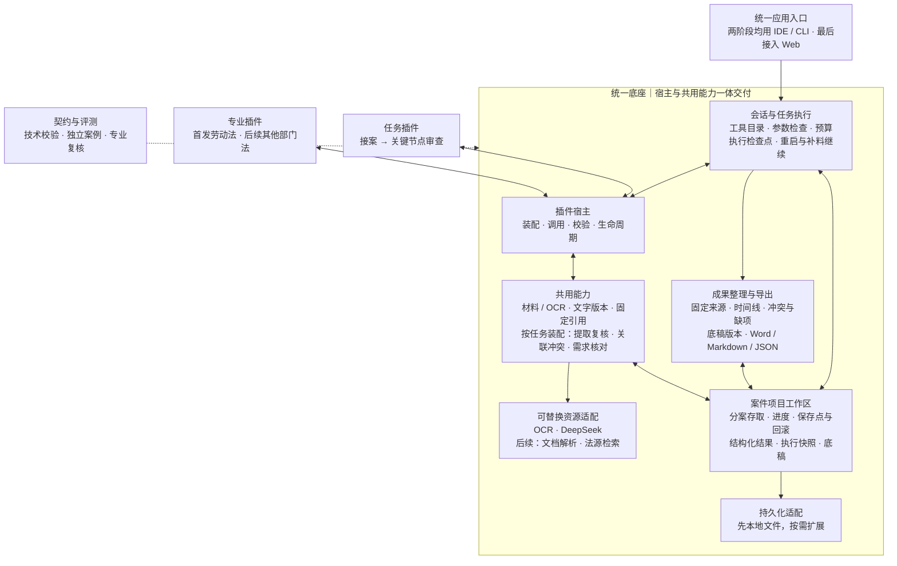
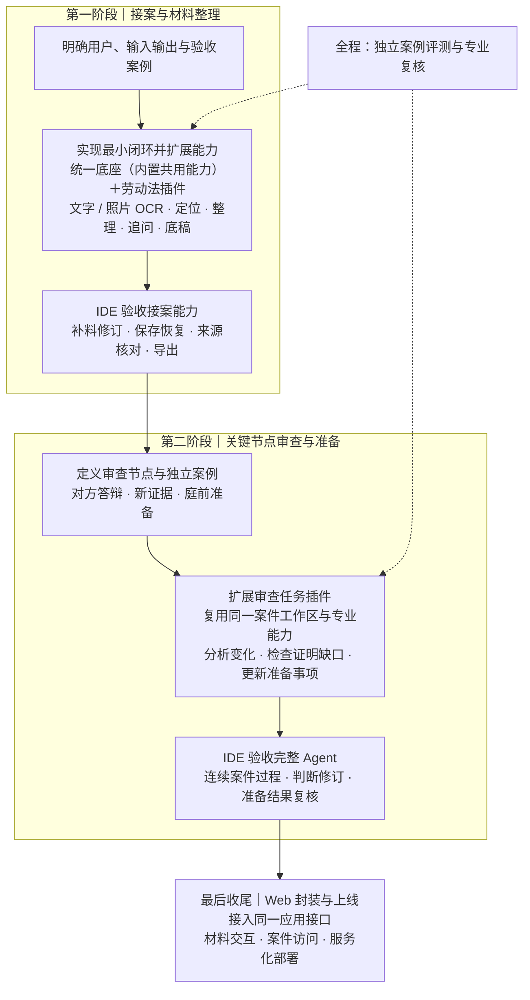

# 法律 Agent 项目笔记

更新：2026-11-02。本文汇总已确认的产品背景、整体架构与实现规划。宿主、材料/OCR、修订引用、案件管理、全案回滚和四项信息整理已有实现；本轮完成模型与执行支持、成果整理与导出初版。现可在终端提出任务，由模型选择已注册工具，执行留检查点并可重启续跑，补料后形成关联的新处理结果，保存和导出有出处的 Word/Markdown 底稿。默认运行时仍提供 32 个能力，信息任务按配置装配 3 个能力，终端通过应用层工具目录组合它们；自我进化后置。

当前重点：[终端执行、恢复与成果交付](../底座/docs/execution-and-outputs.md)。`npm.cmd run agent` 进入案件会话，`demo:agent` 使用虚构材料实际验证中断恢复、补料冲突与新旧底稿；`demo:outputs` 离线检查确定性导出。四项整理的独立验收继续保存在[信息整理说明](../底座/docs/information.md)。这些有限样例不能代替真实复杂卷宗、专业法律质量或跨部门法验证。

当前工程目录：[法律agent3.0 目录总览](C:/Users/13700/Documents/LAW_Agent/法律agent3.0/README.md)。可检查的交付：[底座运行与验收说明](C:/Users/13700/Documents/LAW_Agent/法律agent3.0/底座/README.md)、[插件接入契约](C:/Users/13700/Documents/LAW_Agent/法律agent3.0/底座/docs/plugin-contract.md)。案件保存点现包含 loop 结果、执行快照和案内底稿；工具写入按案件版本检查，回滚后的迟到动作被拒绝。劳动法专业业务、完整接案任务、登录权限和网页仍待后续实现。

职责审阅：[模块职责清单](C:/Users/13700/Documents/LAW_Agent/法律agent3.0/项目规划/module-responsibilities.md)。本轮两项共用底座能力已按计划形成初版，详见[实施清单](C:/Users/13700/Documents/LAW_Agent/法律agent3.0/项目规划/implementation-roadmap.md)。已实现的技术机制与有限模型验收，不代表完整接案业务已经完成。

代码阅读：[host.ts 216 行逐段讲解](C:/Users/13700/Documents/LAW_Agent/法律agent3.0/底座/docs/host逐段讲解.md)，包含分段原代码、语法解释及完整测试插件调用过程。

## 当前重点研究问题（2026-10-31需求核查）

> 开发者只提供某个领域的专业差异，能否复用公共能力，少开发一整套 Agent，同时保持成果质量？

已完成一轮公开资料核查，详见 [专业差异复用与质量保障：现实需求核查](C:/Users/13700/Documents/LAW_Agent/法律agent3.0/项目规划/专业差异复用与质量保障-需求调研.md)。

记录为**有实务依据的重点研究课题，具体架构与优势待验证**。国内存在专业能力封装、维护和复核需求；相近的工作流、Skills与开源法律构建平台已有供给。尚未找到直接证明跨任务复用能降低总投入且专业质量不劣的独立对照证据，不能把插件形式当作已成立的创新。

优先验证专业作者的构建、维护及人工复核总投入，以及关键错误和任务完成度。自动化回归与有限虚构材料验收不足以证明真实业务优势。此前需求核查轮次只记录研究结论、未追加代码；现已进入有限共用能力的实现，通用层价值仍由后续业务任务与公平比较确定。

## 一、项目背景与用途

用户认可的产品背景：

> 最高法在2025年发布的解读中披露，2024年自然人未请律师代理、自行提起的一审案件达 888万件；同时明确指出，诉讼请求、事实和理由表达不清，会造成补充补正、进一步明确请求，甚至增加开庭次数。这里体现的是将生活经历整理成法律案件的困难。

来源：[最高人民法院，2025-01-09](https://www.court.gov.cn/shenpan/xiangqing/452191.html)。其中最后一句为产品推断；888万是案件数量，不能直接理解为独立用户数量或未满足需求人数。

项目要帮助承办人员把当事人的陈述和零散材料，转化为有来源、可核查、能持续修订的案件信息，并进一步形成关键节点的准备事项。

首期使用场景：辅助劳动者一方的律师或法援承办人。劳动法是第一个专业插件；项目的长期贡献在于法律争议办理的通用结构和可扩展插件机制。

## 二、已确认的设计方向

- 定位：法律界的 DeepSeek Harness（DSH），由插件构建业务能力。
- 不再使用 Dify；以 TypeScript 构建可在 IDE 终端独立运行的 Agent。
- 宿主与默认共用能力合为一个可运行底座，内部按职责分模块；用户无需始终另装公共插件。专业能力和业务任务通过统一契约扩展，普通辅助函数不必单独插件化。
- 材料入口支持文字和照片；原图与 OCR 文字分开保存，识别结果待核对，失败可重试。先支持 PNG/JPEG 与本地中英文 OCR，再按实际案例扩展格式。
- 修订无需通过聊天指示 Agent 改字。已有直接提交全文的修订接口和 IDE 文本导出、编辑、保存 CLI，保存为独立新版本并保留原图及旧版本；本轮编辑命令增加 `--case`，草稿保留案件归属。原图对照与可编辑文本的在线页面仍放在最后 Web 阶段。
- 案件工作区先做项目管理：每案独立区域、资料、材料及附件存取、人工办理阶段和状态历史。用户明确选择整个案件恢复到保存点，现已实现命名保存点、变化预览、完整恢复与自动保存点撤销；原件和历史保留。进度不是自动法律判断，`closed` 状态仍允许继续存取。
- 第一阶段实现接案与材料整理，第二阶段实现关键节点审查与准备；两阶段分别在 IDE 验收。
- 两阶段共用案件工作区，第二阶段继续处理第一阶段建立的案件。
- 专业需求与通用整理通过 loop 协作：专业提供方声明问题、字段及理由；通用模块带着需求读取，经引用校验与语义复核后进行关联、冲突和需求核对；再安排必要补查。保留每轮出处与理由，当前采用独立虚构材料验收，自我进化后置。
- Web 封装与上线放在整个实现流程最后；从一开始保留统一应用服务接口。
- 自我进化与第三方插件生态保留为远期议题，当前先建立版本、反馈和评测机制。

设计参考：[DeepSeek Harness 源码](https://github.com/deepseek-ai/deepseek-harness)。通用性需要以后通过其他部门法插件验证，一个劳动插件完成不代表所有法律领域均已适配。

## 三、整体架构图

这是总体架构，箭头表示调用与数据交换，不是所有案件的固定处理顺序。共用模块随底座交付，材料和案件默认装配，信息任务按配置装配。会话层从工具目录选择能力，保存步骤和预算；案件区保存材料、进度、loop、执行快照及底稿。完整法律判断及其变更依赖仍按后续专业案例加入。

| 组成 | 主要贡献 |
| --- | --- |
| 统一底座与宿主 | 一体交付宿主与共用能力；宿主负责装配、调用、校验、工具元数据和清理；应用层负责会话、任务执行和恢复。 |
| 任务插件与共用能力 | 任务插件后续组织完整接案或审查；共用模块提供材料/OCR、版本引用、提取复核、关联冲突和需求核对，并把结果组织为带出处的版本化底稿。 |
| 劳动法插件 | 提供专业争点与事实因子、适用规则、证明任务、必要追问和校验能力。 |
| 案件项目工作区 | 保存每案资料、材料与附件、人工进度、loop、执行快照与底稿；全案保存点可预览、恢复并撤销。完整法律判断及专业任务依赖后续实现。 |
| 资源与持久化适配 | 已对接 OCR 与可替换模型端口上的 DeepSeek；文档处理及法源检索后续加入。存储先用本地文件，SQLite 等按需考虑。 |
| SDK 与评测 | 约束插件接口、输入输出、依赖、版本及验收，支持后续独立开发。 |

首期沿用内部插件契约和测试支持；公开 SDK、第三方生态及跨部门法验证属于远期议题。OCR 结果与失败尝试独立保留并关联原图；已有人工修订、版本绑定引用及引用核验。修订只追加，可形成分支；调用方显式选择文字版本，已有引用不会改指后来的版本。

## 四、实现规划图

第二阶段图中的答辩、新证据与庭前准备是候选节点示例；实施时先选定明确范围，逐个建立独立验收案例。

### 阶段交付

| 阶段 | 主要成果 | 验收重点 |
| --- | --- | --- |
| 第一阶段：接案 | 事实时间线、材料索引、初步问题、关键缺口及接案底稿；支持补料修订、保存恢复与导出。 | 来源可核查；不重复询问已知信息；未知项明确；原始陈述保留；在 IDE 内完成完整接案。 |
| 第二阶段：节点审查 | 针对约定节点输出变化清单、争点与证据关系、证明缺口和优先准备事项。 | 按材料实际出现顺序验证；新信息引起有依据的判断与任务调整；从接案到审查的连续过程在 IDE 内跑通。 |
| 最后：Web 收尾 | 材料上传、原文定位、补料与修订展示、案件访问管理和服务部署。 | 复用同一核心与插件，两大功能在浏览器中完成验收。 |

先以一个完整案例验证用途，再扩展底座和插件能力；共用能力与劳动法能力在最小接口稳定后可并行实现。工期在最小闭环跑通后估计。

前一步底座材料功能技术验收：**登记文字/照片 → 保存原件 → OCR → 重启读回**。当时 Node.js 24.15.0 下类型检查、构建及 45 项测试通过；真实 OCR 引擎识别虚构中英文 PNG、返回两行像素框，源码与构建产物的实际识别、坏图失败后重试及重启读回均通过。这是前一步的历史记录，不是本轮最终测试总数。

前一轮已实现人工全文修订、版本查询、固定版本引用创建和读回核验，并新增 IDE 直接编辑文本的 CLI 与演示；**当时类型检查、构建及 78 项测试全部通过**。实际执行修订演示与 CLI 流程，验证原“8000元”、修订“6000元”及旧新引用在重启后各自保留，文本编辑、两次连续保存和引用读回通过。纯文本原文版本 ID 为 `material.id`，OCR 版本 ID 为成功的 `attempt.id`，修订版本生成 UUID 并记录基准版本、基准哈希、编辑者自报称呼及可选备注；原 `materials.read@1` 保持原样。引用绑定具体版本、UTF-16 区间、摘录与文字哈希；读回可定位原件路径，但不证明法律事实。人工修订不继承 OCR 行框。

前一轮构建产物 `dist/index.js` 的导入与重启读回也通过：当时创建 9 材料能力运行时，恢复源演示写入的两版文字，旧新两个引用分别保持“8000元／6000元”。

此前按用户要求实现案件项目工作区并通过当时技术验收。每案的 `dataDir/cases/{caseId}/` 独立保存资料与进度历史、材料和原始附件；调用显式携带 `caseId`，旧全局材料不自动迁移，也不作为分案查询的回退来源。案件支持创建、列表搜索、打开、资料更新与人工进度标记：`stage` 自由填写，状态为 `active / paused / closed`，关闭后仍可继续存取。更新携带 `expectedRevision`，并发冲突拒绝覆盖；历史保留。

PDF/Word 等原始附件可按字节保存和导出，单附件上限 50 MiB，当前不解析。IDE 提供 `cases` CLI、`demo:cases` 演示，以及保留案件归属的 `materials:text --case` 编辑草稿。案件工作区初版当时共 28 能力，108 项测试通过；实跑演示及构建产物验证 A/B 案独立存取、人工进度、历史重启读回、附件字节和跨案拒绝。这是上一小步的历史记录。

按用户确认实现**整个案件恢复到保存点**。保存点记录案件资料、进度、材料/附件、OCR、版本引用、loop、执行快照和案内底稿。流程为建立保存点、预览变化、携带预览版本号和 token 恢复；恢复前状态自动成为保存点，可再次恢复以撤销。原件和历史保留，固定历史引用可核验，当前视图展示恢复后的集合。案内保存推进案件修订号，过期预览和回滚后的迟到保存会被拒绝。外部副本与未提交草稿不改写，旧进度历史不能追溯补成完整快照。

历史验收（2026-11-01）：全案回滚当时默认 **32 个能力**，类型检查、构建及 **144 项测试通过**；`demo:cases`、`demo:rollback` 和构建产物恢复、重启、撤销均通过。随后 loop 控制通过当时的 183 项测试及保存恢复检查。这些是历史记录，不是当前测试总数。

当前四项整理代码已实现：模型候选经精确引用、字段规范化和单独调用的语义复核后入库；结构化比较区分同义、真正不一致、范围差异与上下文不足；需求核对区分已查/未读、内容一致性、支持类型和满足状态。保留陈述与出处，不把来源标签当鉴真。已完成有限的独立虚构材料验收，结果与限制集中维护在[信息整理说明](../底座/docs/information.md)。

模型与执行支持、成果整理与导出已完成共用底座初版：连续会话通过工具目录调用已有能力；已确认的读取、复核和工具结果可恢复；补料后建立关联运行，预算保留；底稿固定来源、版本及专业贡献，输出时间线、差异和待核对事项，并导出 Word/Markdown/JSON。完整结果与限制见[本轮说明](../底座/docs/execution-and-outputs.md)。下一步按接案案例继续集成劳动法专业插件和完整接案任务，随后实现关键节点审查。法律判断及其变更依赖仍需专业业务完善。案件页面、原图对照和在线编辑仍在最后 Web 阶段；登录权限、云同步及自我进化后置。

## 五、开发与验收约束

1. **先检查已有材料，再提出问题。** 仅追问尚未掌握、无法从材料读取且影响当前判断或下一步工作的信息。
2. **区分陈述与证实程度。** 当事人已经明确说过的内容，即使尚未独立印证，也不能视为没有提供而重复询问。
3. **修订判断，保留原文。** 新材料可改变推断与准备计划，但保留原始陈述、来源和修订记录。
4. **接口独立于交互入口。** IDE/CLI 与最终网页调用同一应用服务；法律规则、案件状态和业务逻辑独立于终端输入输出与 HTTP。
5. **评测贯穿两阶段。** 开发样例与独立验收案例分开，运行时不能读取标准答案。检查来源错误、关键遗漏、重复追问、修订一致性及人工复核时间。
6. **按真实证据报告进展。** 模拟验证与真实案例验证分开；当前不宣称已经实现跨部门法通用、自我进化或提升胜诉率。

## 详细记录

- [产品背景与交互约束](C:/Users/13700/Documents/LAW_Agent/法律agent3.0/项目规划/product-background.md)
- [整体架构与插件契约](C:/Users/13700/Documents/LAW_Agent/法律agent3.0/项目规划/project-architecture.md)
- [实现规划与阶段验收](C:/Users/13700/Documents/LAW_Agent/法律agent3.0/项目规划/implementation-roadmap.md)
